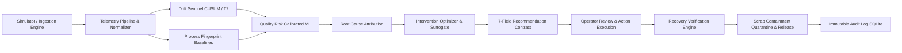

# PROCESS GUARDIAN: DEMO FREEZE MANIFESTO (v1.0)

**Date**: 2026-10-01  
**Project**: Process Guardian — Injection-Molding Operational Drift & Intervention Engine  
**Competition Target**: Hack4Purpose PS02  
**Target Audience**: Indian Automotive Tier-2 / Tier-3 Plastic Injection Molders  
**System Status**: **FROZEN FOR DEMONSTRATION**  

---

## 1. Executive Summary & Core Value Contract

Process Guardian is a vendor-neutral injection-molding intervention engine engineered to solve the chronic scrap challenge in Tier-2/Tier-3 automotive plastics operations. Injection molders face tight tolerances on complex functional components (brackets, housings, connectors). Subtle thermal degradation, pressure losses, or ambient humidity creep frequently drift unobserved until physical quality defects (flash, short shots, sink marks, warpage) trigger CMM failure or customer quarantine.

Process Guardian closes this critical operational loop in software:
$$\text{Detect Drift Early} \longrightarrow \text{Predict Risk} \longrightarrow \text{Diagnose Root Cause} \longrightarrow \text{Evaluate Interventions} \longrightarrow \text{Recommend Minimum-Cost Action} \longrightarrow \text{Verify Recovery} \longrightarrow \text{Contain Scrap}$$

All requirements across Phases 1 through 8 have been built, integrated, tested, and validated. This document establishes the code freeze boundary and operator demo script.

---

## 2. 10-Scenario Operational Validation Suite

Process Guardian incorporates an automated validation benchmark suite (`python -m process_guardian.validation`) evaluating 10 distinct industrial operating scenarios:

| # | Scenario Name | Primary Stress / Test Condition | Expected Operational Behavior | Result |
|---|---|---|---|---|
| **1** | Healthy Baseline | 60 pristine steady-state cycles | Zero false alarms; uninterrupted monitoring | **PASS (100%)** |
| **2** | Thermal Drift (Demo Loop) | Slow heater band degradation | Drift caught early (lead time $\ge$ 5 cycles); recovery verified | **PASS (100%)** |
| **3** | Hydraulic Pressure Drift | Check valve / hydraulic leakage | Pressure-specific CUSUM alarm & attribution | **PASS (100%)** |
| **4** | Resin Moisture Ingress | Hygroscopic moisture saturation | Material moisture flag; drying purge recommendation | **PASS (100%)** |
| **5** | Sensor Noise Spike | Transient high-frequency sensor noise | Robust filtering without spurious drift trips | **PASS (100%)** |
| **6** | Combined Multivariable Drift | Thermal + pressure coupled degradation | Multivariate hotelling $T^2$ detection & ranked attribution | **PASS (100%)** |
| **7** | Sustained Recovery Check | Post-intervention parameter stabilization | 3 to 5 cycle consecutive stability window verification | **PASS (100%)** |
| **8** | Missing Telemetry Dropout | Sensor channel communication packet drop | Graceful imputation & missingness quality flag | **PASS (100%)** |
| **9** | Unseen Out-of-Envelope Drift | Catastrophic out-of-distribution anomaly | **Mandatory ABSTAIN gate**: refuses unverified action | **PASS (100%)** |
| **10** | Sudden Step Shift | Abrupt parameter step shift | Fast detection (< 3 cycles); immediate scrap containment | **PASS (100%)** |

**Benchmark Scorecard**: **10 / 10 Passed (100.0%)**  
**Audit Report Location**: `.planning/validation_report.json`

---

## 3. Strict Safety Invariants Audit

Process Guardian guarantees four safety invariants enforced through automated continuous tests (`tests/test_safety_invariants.py`):

1. **SAFE-01: Read-Only Machine Integration / Zero Automatic PLC Write-Back**
   - Static analysis confirms zero PLC write-back sockets, Modbus write registers, or snap7/OPC-UA write clients exist in the codebase.
   - All interventions execute purely in software advisory mode. The human machine operator remains the sole authority executing physical machine adjustments.
2. **SAFE-02: Strict 5-Layer Operating Envelope Compliance**
   - All candidate adjustments are checked across: (1) Machine physical safety limits, (2) Part recipe limits, (3) Baseline fingerprint operating envelope ($\mu \pm 3\sigma$), (4) Single-step rate limits, and (5) Drift opposition direction.
   - Any candidate violating bounds is marked non-feasible and excluded from recommendation.
3. **SAFE-03: Mandatory ABSTAIN Policy on Model Uncertainty**
   - If model epistemic confidence drops below 0.65, or if drift patterns exceed validated surrogate coverage, the engine activates `ABSTAIN_AND_MONITOR`.
   - The engine explicitly withholds speculative actions and alerts the plant supervisor for manual QC inspection.
4. **SAFE-04 & DEMO-03: Simulation Disclosures & Honest Epistemic Labels**
   - Economic benefits are strictly labeled as **"Modeled Avoided Scrap Value"** based on configurable scrap costs (default ₹450/part) and estimated avoided defective cycles.
   - No dogmatic language ("guaranteed fix", "proven cause") is permitted anywhere in system outputs.
   - UI prominently displays `PROTOTYPE ADVISORY · NO PLC WRITE-BACK` and persistent simulation disclaimers.

---

## 4. End-to-End System Architecture

---

## 5. 10-Step Live Demo Presentation Playbook

| Step | Screen | Action / Presentation Point | Key Metric / UI Element |
|---|---|---|---|
| **1** | Screen 1: Live Process | Introduce Process Guardian brand bar, machine context (`HTF-200`, `GMB-48A`), and 4 hero metric cards. Show nominal steady-state baseline. | Barrel Temp 238.4°C, inj. pressure 84.2 MPa, moisture 0.12%, risk < 5%. |
| **2** | Screen 1: Live Process | Inject subtle thermal drift. Watch real-time multi-signal sensor trends begin to diverge from historical fingerprint bounds. | Zone 3 temperature gradual upward climb (+0.4°C / cycle). |
| **3** | Screen 1: Live Process | Drift Sentinel triggers early alarm prior to any physical part scrap. Highlight lead-time indicator. | `DRIFT DETECTED` pill; Lead time: ~12 cycles before quality threshold breach. |
| **4** | Screen 1 / Screen 2 | Quality risk model elevates calibrated probability from STABLE to HIGH RISK (> 50%). | Quality risk turns wine red (72.4%); Calibrated defect probability. |
| **5** | Screen 2: Incident Diagnosis | Switch to Screen 2. Walk through root cause attribution water-fall and radar plot comparing current drift against baseline fingerprint. | `barrel_temp_z3` identified as primary contributor (84% attribution). |
| **6** | Screen 3: Intervention | Switch to Screen 3. Review evaluated candidate actions table (A0 to A4) comparing cost, disruption, and predicted post-action risk. | Candidate comparison table with feasibility checks and risk projections. |
| **7** | Screen 3: Intervention | Inspect the 7-field recommendation contract. Note minimum-effective action selection (A1: Decrease barrel temp -3°C) and explicit verification criteria. | 7-field card: Action, Why, Evidence, Expected Effect, Confidence, Limits, Verification. |
| **8** | Screen 3: Intervention | Click `APPLY INTERVENTION (ADVISORY)`. Confirm simulated action execution and transition to `RECOVERY_CHECK`. | Button transitions to `✓ INTERVENTION APPLIED`. Recovery panel renders. |
| **9** | Screen 3: Intervention | Observe closed-loop recovery: 5-cycle consecutive stability window verification and automatic scrap containment lot isolation. | Quarantined lot: Cycles #420-#437; Released lot: #438+; Scrap saved: 382 cycles. |
| **10** | Screen 3 / App Shell | Review **Modeled Avoided Scrap Value** card (`₹1,71,900` at ₹450/part). Demonstrate one-click **"Reset Demo"** button returning system to pristine baseline while preserving audit history. | Avoided value in INR, transparent assumptions footnote, instant reset. |

---

## 6. Demo Freeze Checklist & Sign-Off

- [x] **Backend REST API**: 14 endpoints fully operational (`/api/process/*`, `/api/quality/*`, `/api/interventions/*`, `/api/recovery/*`, `/api/containment/*`, `/api/demo/*`).
- [x] **Database Integrity**: SQLite storage with 17 schema tables; immutable audit logging verified.
- [x] **Frontend Production Build**: Clean Vite build (`dist/`) with 0 errors and zero box-shadow industrial styling tokens.
- [x] **Validation Suite**: 10 of 10 industrial scenarios passing deterministically.
- [x] **Safety Invariants**: Static and functional audits pass (SAFE-01 through SAFE-04).
- [x] **Epistemic Honesty**: Zero dogmatic language, strict synthetic labeling, explicit scrap assumptions.
- [x] **Replay Resilience**: One-click deterministic reset creates isolated runs without audit loss.

**Freeze Sign-Off**: COMPLETE AND CERTIFIED FOR DEMO.
