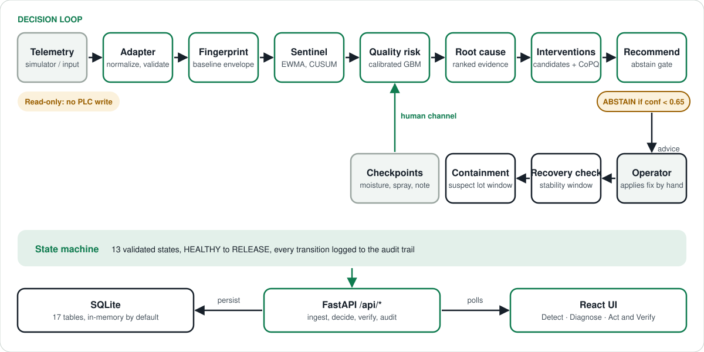

# Process Guardian

**A decision layer for injection-molding drift.** It spots process drift before any sensor limit trips, prices waiting against acting, recommends the smallest safe fix, verifies recovery, and quarantines only the suspect lot.

Built for **Hack4Purpose, PS02** (real-time process and raw-material quality monitoring), aimed at Indian automotive Tier-2/Tier-3 molders. **Advisory only: it never writes to the machine.**

| Result on the bundled simulator (scenario 6, compound drift) | Without Guardian | With Guardian |
|---|---|---|
| Defective parts | 76 | 9 |
| Suspect lot quarantined | 85 | 21 |
| Modeled loss | ₹18,511 | ₹1,128 |
| Drift flagged at cycle | SPC alarm at 84 | 72 |

These are **modeled, simulator-only** numbers (evidence Level 4). They are not plant data. See [Known limitations](#14-known-limitations).

## 1. Product overview

Process Guardian sits beside an injection-molding machine. It reads cycle telemetry (barrel temperature, injection pressure, moisture and operational signals), decides whether the process is drifting, and tells the operator what to do and what it costs. The operator applies any change by hand. A React UI shows the loop in three screens: **Detect**, **Diagnose**, **Act and Verify**.

## 2. Problem

Drift in temperature, pressure, resin moisture or setup usually goes unnoticed until parts fail inspection, and then a whole lot is suspect. PS02 cites 6-7% rejection against an automotive target of 2% or less. Operators must choose between stopping, adjusting or running on, with little quantified basis.

## 3. Solution

One closed decision loop:

1. **Detect** drift with EWMA, CUSUM, trend and multivariate (Mahalanobis) monitors.
2. **Predict** the quality-contract risk of each cycle and **diagnose** the likely cause.
3. **Evaluate** the cost of waiting against the cost of acting (CoPQ model, in ₹).
4. **Recommend** the minimum-effective action, or **ABSTAIN** when confidence is below 0.65.
5. **Verify** recovery with a stability window and a physical QC checkpoint.
6. **Contain** the suspect lot, from the last known-good cycle to QC release.

## 4. Key features

- **Drift detection:** EWMA, CUSUM, sliding trend and multivariate detectors against a per-machine process fingerprint.
- **Calibrated quality risk:** gradient-boosted classifier with probability calibration, scored against a Quality Contract.
- **Root-cause ranking:** feature-contribution evidence per incident.
- **Constrained interventions:** candidate actions scored by risk, cost and disruption against machine, recipe and fingerprint limits, using a surrogate model.
- **ABSTAIN gate:** low confidence or out-of-distribution drift holds production and requests inspection instead of acting.
- **Operator checkpoints:** recipe lock (R-12), resin moisture check, mold-release spray interval, and a free-text operator note.
- **Human channel:** a deterministic parser maps short shop-floor replies (English, plus Hindi, Tamil and Kannada phrasing) to a typed yes/no signal.
- **Recovery and containment:** stability-window check, suspect-lot window, quarantine and release.
- **Counterfactual replay:** the same event stream with Guardian OFF and ON, compared side by side.
- **Evidence labels:** every result is tagged Level 1 (challenge) to Level 4 (controlled counterfactual).
- **13-state machine** (`HEALTHY` to `RELEASE`) with an audit trail.
- **Scenarios:** 9 selectable scenarios through the API and a 10-scenario validation suite.

## 5. Architecture



| Package (`src/process_guardian/`) | Role |
|---|---|
| `simulator/`, `scenario/` | Deterministic cycle simulator, scenario registry and runner |
| `adapter/`, `fingerprint/` | Normalize and validate telemetry; build the baseline envelope |
| `sentinel/` | EWMA, CUSUM, trend and multivariate drift detectors |
| `quality/`, `root_cause/` | Risk model, Quality Contract, operator checkpoints, cause ranking |
| `intervention/`, `economics/` | Candidates, optimizer, surrogate, recommendation, CoPQ and cost of waiting |
| `recovery/`, `containment/` | Recovery verifier and scrap-containment engine |
| `state_machine/`, `lifecycle.py` | 13-state engine and the loop orchestrator |
| `counterfactual/`, `evidence/`, `validation/` | OFF/ON replay, benchmark and grounding report, validation suite |
| `llm/`, `storage/`, `api/` | Human-channel parser, SQLite layer, FastAPI app |

## 6. Tech stack

- **Backend:** Python 3.12+, FastAPI (0.143+), Uvicorn, Pydantic 2, NumPy, scikit-learn (SciPy comes with it)
- **Frontend:** React 19, Vite 8, Recharts 3, oxlint
- **Storage:** SQLite (standard library)
- **Tests:** pytest, httpx

## 7. AI architecture

Mostly deterministic. The learned parts are small and bounded:

- **Quality-risk model:** `GradientBoostingClassifier` in `CalibratedClassifierCV`, trained at startup on synthetic multi-regime data. Its probabilities are calibrated to the simulator, not to a real plant.
- **Intervention surrogate:** a forward model that predicts a candidate action's effect inside the optimizer.
- **Human-channel parser:** deterministic rules first, and a confident match is final.
- **Laya (optional, off by default):** a local multilingual model, consulted only when the parser returns UNKNOWN. Its reads are capped below an exact rule match and tagged `source="laya"`. It can never override a rule verdict, and the loop works without it. It has not been validated for typed decisions.

## 8. Database

SQLite with **17 tables**, created on startup: machines, molds, parts, recipes, materials, cycles, process fingerprints, quality contracts, drift events, quality predictions, intervention candidates, recommendations and applications, recovery events, containment windows, checkpoints and an audit log. The default is `:memory:`, so **state resets when the server restarts**. Pass a file path to `ServiceContainer(db_path=...)` to persist it.

## 9. API and integrations

Base URL `http://localhost:8000/api` (interactive docs at `http://localhost:8000/docs`).

| Group | Endpoints |
|---|---|
| System | `GET /health` |
| Ingest | `POST /cycles`, `/events`, `/checkpoints` |
| Process | `GET /process/current`, `/process/fingerprint`, `/process/drift`, `/process/audit-trail` |
| Quality | `GET /quality/risk`, `/quality/contract` |
| Interventions | `POST /interventions/simulate`, `/interventions/apply-demo`; `GET /interventions/recommendation`, `/interventions/history` |
| Recovery and containment | `GET /recovery/status`, `/containment/window`, `/containment/boundary`; `POST /containment/release` |
| Operator checkpoints | `GET /checkpoints/operational`; `POST /checkpoints/spray`, `/checkpoints/moisture`, `/checkpoints/human-channel` |
| Economics | `GET`/`POST /economics/parameters`; `GET /economics/copq`, `/economics/decision-value` |
| Evidence | `GET /evidence/levels`, `/evidence/external-benchmark`, `/evidence/grounding-report` |
| Counterfactual | `GET /counterfactual/compare`; `POST /counterfactual/replay` |
| Scenarios | `GET /scenarios`, `/scenarios/active`, `/scenarios/validation-suite`, `/scenarios/{id}`; `POST /scenarios/select`, `/scenarios/{id}/select`, `/scenarios/{id}/run` |
| Demo | `POST /demo/reset`; `GET /demo/economic-impact`, `/demo/runs` |

**External integrations at runtime: none.** The "external benchmark" is a deterministic replica of the published SKZ / Fraunhofer IPA injection-molding DoE, generated in code. It is not the raw published dataset.

## 10. Local setup

Needs Python 3.12+ and Node.js 20.19+ or 22.12+.

**Windows, one command** (installs what is missing, starts the engine on :8000 and the UI on :5173):

```bat
demo.cmd
```

**Manual:**

```bash
python -m pip install -e .            # add ".[laya]" for the optional model (large download)
PYTHONPATH=src python -m uvicorn process_guardian.api.app:app --port 8000   # PowerShell: $env:PYTHONPATH="src"
cd frontend && npm install && npm run dev                                   # http://localhost:5173
```

Check it: `curl http://localhost:8000/api/health` returns `"status": "HEALTHY"`.

## 11. Environment variables

| Variable | Where | Default | Purpose |
|---|---|---|---|
| `PROCESS_GUARDIAN_LAYA_ENABLED` | Backend | `0` | `1` enables the optional Laya fallback (needs the `laya` extra) |
| `VITE_API_URL` | Frontend (`frontend/.env.local`) | `http://localhost:8000` | Backend base URL. The Vite dev server also proxies `/api` to `127.0.0.1:8000` |
| `PYTHONPATH` | Backend run | none | Must include `src` when running uvicorn from the repo root |

No secrets are required.

## 12. Deployment

**Not deployed.** This is a local, offline-capable demo: no Dockerfile, no CI, no hosted service. A hosted version would need a persistent `db_path`, a restricted CORS list (currently `*`) and authentication.

## 13. Testing

```bash
python -m pytest -q                                                        # backend, API and safety-invariant tests
python -m process_guardian.validation --output validation_report.json      # 10-scenario suite
cd frontend && npm run build && npm run lint
bash scripts/verify.sh                                                     # full gate
```

Last run on this tree: **233 passed, 2 skipped** (235 collected); validation suite **10 / 10 passed**; `scripts/verify.sh` **PASS 6/6**. Safety invariants `SAFE-01` to `SAFE-04` (read-only integration, operating-envelope limits, mandatory abstain, honest labels) are checked in `tests/test_safety_invariants.py`.

## 14. Known limitations

- **Simulated data only.** There is no live plant feed, and the quality model is trained on simulator data.
- **The external benchmark is a replica**, so its results are Level 2, not plant-trial evidence.
- **No authentication or authorization**, and CORS allows every origin. Endpoints such as `POST /containment/release` are open.
- **In-memory database by default.** Restarting the backend clears state.
- **Read-only by design.** There is no PLC write-back, so every adjustment is operator-applied.
- **Laya is not validated for typed decisions.** The deterministic parser carries the correctness claims.
- **Not yet run on a production machine.**

## 15. Future improvements

- Ingest real machine telemetry through a documented adapter, and validate the risk model on plant data.
- Make persistence the default, with a documented backup and reset path.
- Add authentication and a tighter CORS policy before any hosted deployment.
- Fine-tune and measure Laya on shop-floor phrasing before it is allowed on the decision path.

---

*Hack4Purpose PS02. Process Guardian is a decision-support prototype: its outputs are advisory and must be verified by operators and quality staff before any action on the line.*
